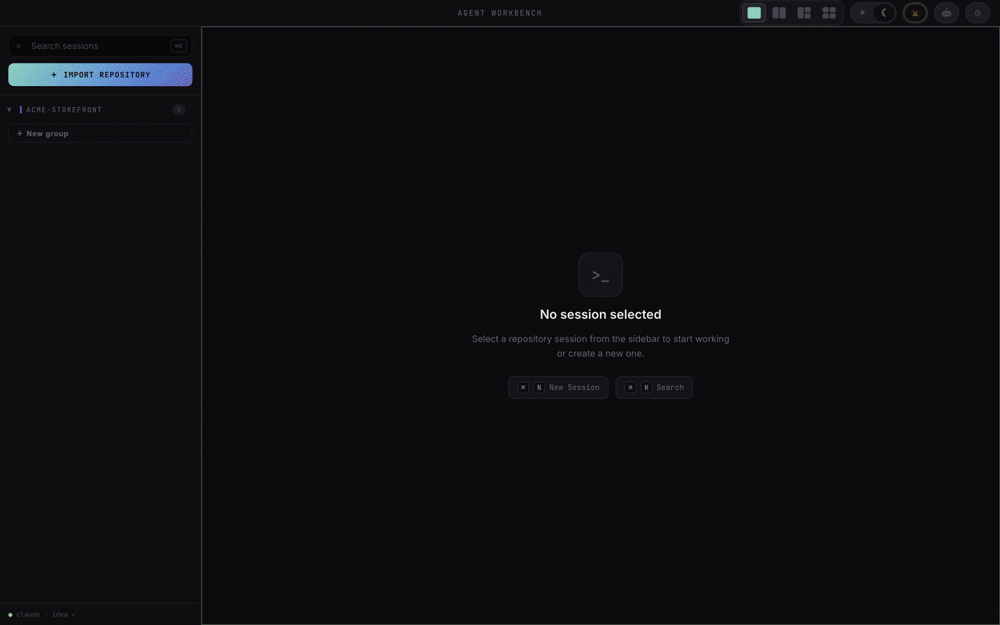

# Agent Workbench

[](https://github.com/Vocabulo-Confiante/agent-workbench-releases/releases/latest)

A desktop workbench for running and supervising CLI coding-agent sessions.
Bring your favorite CLI agent: each session runs in a real terminal, and the
workbench adds the supervision layer a plain terminal lacks.

## A day in the workbench

Import a repository, start a session, let the agent work, review the diff,
and browse the agent definitions available to the project:


## What it does

- **Sessions per repository.** Import a repository and it becomes a group.
  Every agent session you start there is tracked with its branch, live status
  (running, waiting for input, done, error), and desktop notifications when a
  session needs you.
- **Real terminals.** Each session is a full PTY. Nothing is proxied or
  rewritten; you interact with the agent exactly as you would in a terminal.
- **Multi-pane layouts.** Run several sessions side by side and switch
  layouts from the title bar.
- **Diffs and CI at a glance.** Live diff summaries against a baseline, a
  full diff viewer, the CI status of the linked pull request, and one click
  to open the repository in your IDE.
- **Forge integration.** Sign in with GitHub or GitLab through credential
  profiles you control. Token scopes are documented in the app, with the
  reason each one is needed.
- **Agent Roster.** Every reusable agent definition visible to a repository,
  presented as a browsable team roster with model, scope, and tool details.
- **Cost tracking, MCP inspection, themes, text scaling, and localization**
  (English and Portuguese) are built in.

## PR Hero

A companion mini game that turns your open pull requests into monsters along
a road. Create a hero, pick a class, and watch your team fight: teammates
appear as allies with the role they played on each pull request, CI progress
chips away at monster health, and merging a pull request defeats its monster,
awarding experience, loot, and coins for the shop.



## Download

Get the installer for your platform from the
[**latest release**](https://github.com/Vocabulo-Confiante/agent-workbench-releases/releases/latest).

| Platform | File | Notes |
|---|---|---|
| macOS (Apple Silicon) | `Agent.Workbench-<version>-arm64.dmg` | Signed and notarized |
| Windows (x64) | `Agent.Workbench.Setup.<version>.exe` | NSIS installer |
| Linux (x64) | `Agent.Workbench-<version>.AppImage` | Portable, no install |
| Linux (Debian/Ubuntu) | `agent-workbench_<version>_amd64.deb` | System package |

All previous versions remain available on the
[releases page](https://github.com/Vocabulo-Confiante/agent-workbench-releases/releases).

## Installing

**macOS.** Open the `.dmg` and drag Agent Workbench to Applications. The
build is Developer ID signed and notarized by Apple and opens without
warnings.

**Windows.** Run the installer. SmartScreen may warn on first launch until
the build is Authenticode signed: choose More info, then Run anyway.

**Linux.** Make the AppImage executable and run it, or install the package:

```bash
chmod +x Agent.Workbench-*.AppImage && ./Agent.Workbench-*.AppImage
# or
sudo dpkg -i agent-workbench_*_amd64.deb
```

## Requirements

The settings screen detects the tools already on your machine and can
validate a custom path or install a missing one with your system's package
manager. None of them are required to start the app:

- Your preferred CLI coding agent
- `git`, plus the GitHub or GitLab CLI for forge features such as CI status
  and PR Hero
- Optionally an IDE launcher for the open-in-IDE shortcut

## Releases and versioning

Versions follow `v<major>.<minor>.<patch>` tags. Release notes are generated
from the commit history and grouped by change type, so they reflect exactly
what shipped. Versions below 1.0 are early builds published ahead of the
first stable version.

Every release is built and published by CI. The pipeline runs the full test
suite and real-machine install integration tests on macOS, Windows, and
Linux before packaging, so a build with a broken installer never publishes.

## Feedback and issues

Found a bug or have a feature request? Open an issue in this repository's
[issue tracker](https://github.com/Vocabulo-Confiante/agent-workbench-releases/issues).
Please include your operating system, the app version, and steps to
reproduce.
